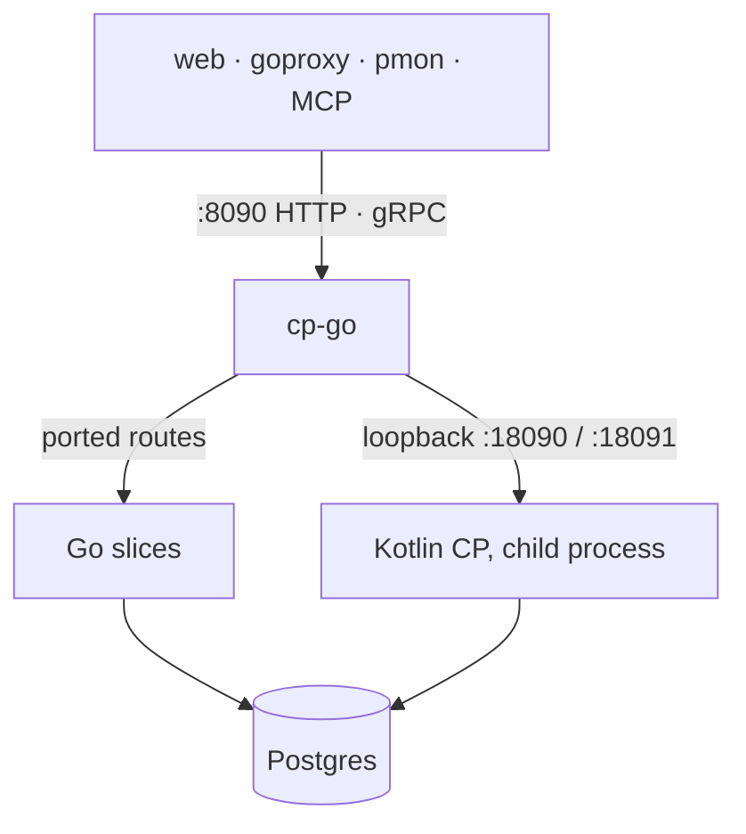

# Control plane to Go — migration plan

The control plane is the last Kotlin component. This plan moves it to Go one
slice at a time, behind a Go process that owns its ports from the first step.

This file is a summary. The original plan, with diagrams, phase status, and the
per-phase file lists, is the
[plan artifact](https://claude.ai/artifact/9V3VoaADjrYinG6TpJLVc7); viewing it
requires access granted by the maintainers.

Status: phases 0–2 done; phases 3–5 in progress (Go decides Cedar for the routes
it serves; roles, mask functions, policies and their schema, JIT access
requests, users, groups, datasource read, wire cert, create, edit and delete,
wire tokens, and request threads run on Go); phase 6 in progress (web sessions,
OIDC login, the IdP recheck, pmon's device login and its daemon session, and the
CI token exchange run on Go); phase 7 in progress (the `ReportCompletion` RPC
runs on Go, every other RPC is forwarded); phase 8 in progress (the MCP OAuth
authorization server runs on Go).

## Shape

A Go front door, `cp-go`, takes over `:8090` and the gRPC port. It starts the
Kotlin control plane as a child process on loopback ports and forwards every
route it does not serve itself. Each phase then moves a whole slice (routes,
service, and store together) into Go and deletes the Kotlin code. Clients see no
change.

`cp-go` passes the same `PM_*` environment to the child with
`PM_HTTP_PORT=18090`, `PM_GRPC_PORT=18091`, and `PM_BIND_HOST=127.0.0.1`. The
bind host is new: without it Kotlin listens on every interface and can be
reached without going through `cp-go`. If the child exits, `cp-go` exits.

Until a slice moves, the processes call each other over loopback with the
per-boot `PM_CP_INTERNAL_TOKEN`, one token for both directions:

- Go to Kotlin: HTTP `/internal/*`, such as `POST /internal/policies-changed`
  while Kotlin still caches policies. It only shrinks, so it stays HTTP.
- Kotlin to Go: gRPC. When Kotlin code that stays for now needs an operation Go
  owns, the slice gets a service in its own file under `proto/src/main/proto/`.
  `cp-go` serves it through `cpgo/gobridge` on a loopback port it names to the
  child as `PM_CP_GO_GRPC_ADDR`, checking the token in the `x-pm-internal-token`
  metadata, and Kotlin calls the generated stub on `CpGoBridge.channel`. Kotlin
  tests run a fake of the service. A whole operation crosses; a single row
  inside a Kotlin transaction does not. A service is deleted when its Kotlin
  caller moves to Go, and the listener with the last one (phase 8).

| Service        | Kotlin caller                                                                 | Deleted when                      |
| -------------- | ----------------------------------------------------------------------------- | --------------------------------- |
| `GitHubSource` | the SQL-from-GitHub flow ([sql-from-github.md](./sql-from-github.md#sources)) | the flow moves with approvals (5) |

Both processes ship in the existing control-plane image, with `cp-go` as the
entrypoint, so deployment does not change. After the last phase the image is one
Go binary with no JRE and no native libraries.

## Phases

```mermaid
gantt
  dateFormat X
  axisFormat %s
  section Working days
  0 Front door          :0, 3
  1 Session gate        :3, 5
  2 Access-check bridge :5, 6
  3 Leaf slices         :6, 12
  4 Cedar and roles     :12, 18
  5 Admin CRUD          :18, 24
  6 Login and sessions  :24, 30
  7 Per-query path      :30, 39
  8 MCP, OAuth, cleanup :39, 43
```

| #   | Phase               | Moves                                                                     | Kotlin lines | Done when                                                       |
| --- | ------------------- | ------------------------------------------------------------------------- | ------------ | --------------------------------------------------------------- |
| 0   | Front door          | Port ownership, child process, forwarding                                 | 0            | e2e passes through `cp-go`; the JVM is unreachable from outside |
| 1   | Session gate        | Go reads console sessions; locale and query-history routes                | 50           | Go accepts exactly the sessions Kotlin does                     |
| 2   | Access-check bridge | Go routes ask Kotlin through one `Authorize` RPC                          | 0            | Every Go route calls a gate helper                              |
| 3   | Leaf slices         | Notifications, audit routes, connection info, SCIM                        | 2,930        | The audit chain verifies across the switch                      |
| 4   | Cedar and roles     | `cedar-go` replaces `cedar-java`, `RoleResolver` moves; bridge deleted    | 2,136        | No differences on a recorded request set                        |
| 5   | Admin CRUD          | Datasources, users, access, policies, approvals                           | 7,081        | Console admin and approvals run on Go                           |
| 6   | Login and sessions  | OIDC login, device login, wire tokens, `ValidateToken`, IdP recheck sweep | 2,907        | Web, pmon, and MCP login work end to end                        |
| 7   | Per-query path      | Catalog, `Decide`, `RunExec`, events, Athena                              | 6,643        | MySQL wire and editor masking match Kotlin                      |
| 8   | MCP, OAuth, cleanup | MCP server, OAuth, Flyway handover; delete the JVM build                  | 4,927        | The full gate passes with no JVM                                |

Login comes after admin CRUD because it provisions users and groups from the IdP
and gates on resolved roles; it moves once both are in Go.

Estimated at 31–46 working days in total.

## Approval workflow still in Kotlin

The query-request workflow (`ApprovalService.kt`, `Approvals.kt`, the notify
layer) moves in phase 5's approvals slice. Go already serves the own-requests
list, with each request's `ccs`, and the `/api/requests/**` thread routes
(timeline, comments, CCs, close, the involved list); after each write Go asks
Kotlin's `/internal/request-notified` to send the notification. MCP and Slack
still call Kotlin's `RequestThreads`. The port must keep:

- Running an approved request is gated by `task.run`, not by who approved it.
- An approval expires after 24 hours (`APPROVAL_TTL`): the claim to run refuses
  an older one, and a sweep returns it to `PENDING` with `TASK_REOPENED`. GitHub
  requests are exempt.
- Unapprove, reject of an approved request, and a `request_event` row for every
  change.
- Slack channel and thread messages never carry the full statement.

## Cedar in Go

cp-go decides Cedar with cedar-go for the routes it serves. Kotlin keeps
deciding the query path with cedar-java until phase 7, so a policy change made
by Go is still signalled to it; a change Kotlin makes reaches Go through a
fingerprint of the enabled policies checked on each decision. Policy validation
uses cedar-go's experimental validator, whose error wording differs from
Kotlin's.

## Risks

- In-memory state split across two processes. The events hub, the task
  completion hub, SSE streams, and the Cedar policy cache assume one process.
  Use Postgres `LISTEN/NOTIFY` while both run, and move each hub with every
  writer to it.
- `cedar-go` and `cedar-java` can disagree. Diff both on recorded requests
  before switching.
- The audit hash chain breaks if Go's canonical form differs by one byte from
  `AuditCanonical.kt`. Test both on the same rows first.
- Kotlin's Flyway owns migrations until phase 8; a Go runner then takes over the
  same files and history table.
- cp-go reads `PM_DB_URL`, `PM_DB_USER`, `PM_DB_PASSWORD` and
  `PM_CP_INTERNAL_TOKEN` from the environment only, because the Kotlin child
  reads the same variables. Once Kotlin is gone they become ordinary flags with
  environment defaults, like the rest of cp-go's settings.
- Code that only bridges to Kotlin's conventions retires with it: `store.DSN`
  (the JDBC `PM_DB_URL` turned into a pgx DSN) and the JDBC URL in
  `internal/dbtest`, the `/internal/` bridge, and the cp-go → Kotlin signals.
- `api.WriteJSON`'s byte-for-byte match of Kotlin's serializer (no HTML
  escaping, no trailing newline): plain `json.Encoder` once no comparison
  against Kotlin remains.
- Go handlers return the same `ApiError(code, params)` and use the same gate
  helpers, built in phase 0.
