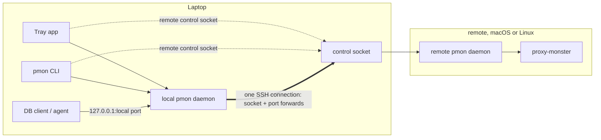

# pmon remote daemon

Run the pmon daemon on a macOS or Linux machine reached over SSH, and drive it
from the laptop: sign in with the laptop's browser, see it in the tray and
`pmon`, and connect to its datasources as if they were local.

This file is a summary. The original design, with the diagram and open
questions, is the
[design artifact](https://claude.ai/artifact/BTJw1gsknMRdypvpnQhy2b); viewing it
requires access granted by the maintainers.

Status: built.

## Settled

- The tray and the CLI drive the remote daemon, and its datasources work from
  the laptop.
- The control socket is forwarded over SSH; nothing listens on a new network
  port.
- The remote is macOS or Linux. A Windows laptop is not a goal: no code of its
  own, and no code to block it.
- The laptop's AI apps can use a remote's servers, but `pmon mcp --install`
  installs only local ones unless asked for a remote.
- A stopped remote daemon starts on demand (Start in the tray, any CLI command).

## Design

- `pmon remote add <ssh-target>` saves a remote in the laptop's config. The
  target (a `Host` alias, host, or `user@host`) is also the remote's name, so a
  short name, keys, agents and jump hosts all come from `~/.ssh/config`.
- The local daemon owns one shared SSH connection per remote
  (`ssh -M -N -o BatchMode=yes`), so forwards outlive the tray and serve the
  CLI. It finds the remote socket with a new `pmon socket-path` command and
  forwards it into the laptop's `0700` state folder. It reconnects with backoff
  and re-adds every forward; Reconnect skips the backoff.
- Each remote datasource gets a sticky local port from the local daemon's own
  range, forwarded to the remote daemon's port, so local and remote ports never
  collide. Connection strings use the local port and the remote daemon's local
  password.
- The local daemon's `/status` gains `remotes`: target, state (connected,
  connecting, no daemon, down) with the last SSH error, the forwarded socket,
  and the port map.
- CLI: `--remote <ssh-target>` or `PMON_REMOTE` points any command at the remote
  daemon through the forwarded socket; plain `pmon status` lists each remote's
  state.
- Tray: each remote is a menu group with the usual server and datasource items.
  Sign-in links come from the remote daemon and open in the laptop's browser.
- The remote needs sshd's default `AllowStreamLocalForwarding` and
  `AllowTcpForwarding`. The daemon's socket is found by listing
  `/tmp/pmon-<uid>/`, so a running daemon needs no `pmon` on the remote's PATH;
  only starting one does, with `pmon` from the login-shell PATH or else Proxy
  Monster Desktop's bundled one.

## Build plan

1. Remotes and the tunnel: `pmon remote`, `pmon socket-path`, the SSH
   connection, `remotes` in `/status`.
2. Datasource forwards and the port map.
3. CLI `--remote`.
4. Tray groups, Settings › Servers, notifications.
5. AI apps: `pmon mcp --remote <target>`, and
   `pmon mcp --install --remote <target>` for entries such as
   `pmon-<target>-<server>`.
